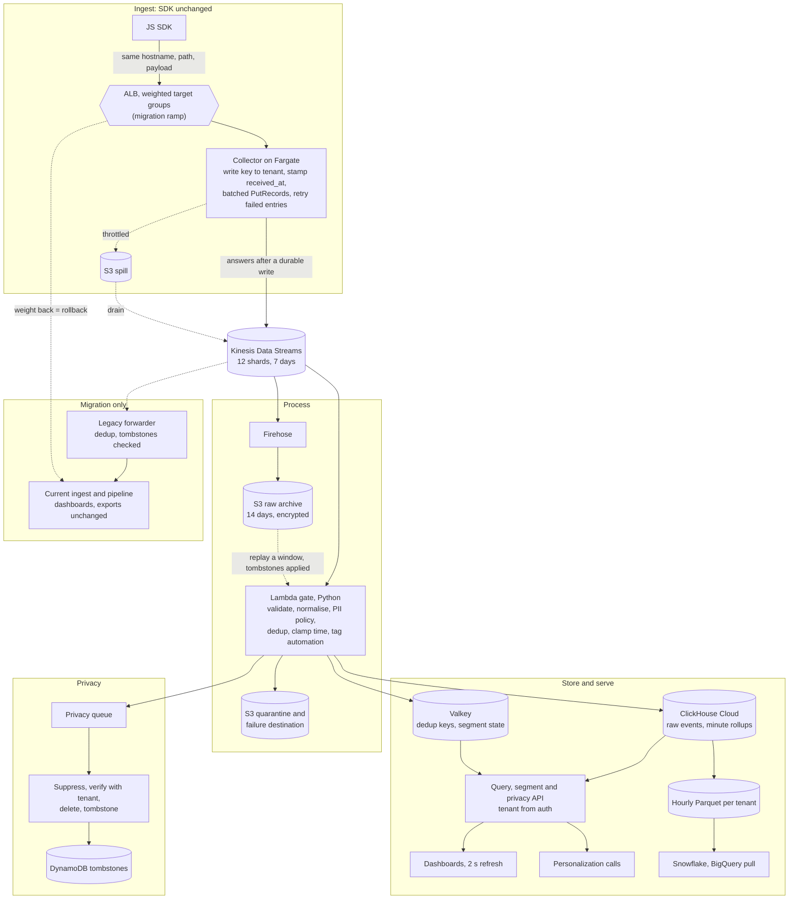

# Engineer 004: real-time analytics pipeline

**Brief version: 2026-07** (https://github.com/ericosiu/beat-claude, commit `4b719e45`) [Observed]. **Fixture:** official `event_sample.jsonl`, 25 lines, SHA-256 `1aeb24b415009e89fcf8acb5a178410faf216dc17b16920d9849ecc8bbb24235`, fetched and checked by `tools/fetch_fixture.py`, not redistributed (no upstream license). Every `event_id` below comes from `analyze_fixture.py`; details in `docs/design_notes.md`, diagram in the appendix.

## 1. Written answer

### Decision and arithmetic

[Estimated] 50M events a day is 579 events/s, 5,787 at a 10x spike; at 1 KB per event [Assumed], 5.8 MB/s at peak and 1.5 TB a month. That is small, so the complexity goes where the risk is: correctness and migration. A collector behind the existing SDK hostname writes each event to Kinesis before answering; a Python Lambda, the gate, validates, deduplicates and tags events with the rules of `analyze_fixture.py`; ClickHouse serves dashboards from minute rollups; Valkey holds dedup keys and segments; Firehose archives raw events to S3 for replays. No Flink, no Kafka.

[Estimated] Monthly list cost (`cost_model.py`, AWS Price List API): ClickHouse $2.7K, Valkey $0.5K, Kinesis $0.3K, collector and ALB $0.3K, Firehose $0.2K, rest $0.6K, staging $1.6K: **$6.3K, 13% of the ceiling**. Provisioned for 25x: $7.6K. A permanent 10x volume: $24.7K, over the ceiling if ClickHouse compute must grow tenfold too.

### Choices, and what I rejected

| Layer | Choice | Rejected, and why |
|---|---|---|
| Front door | ALB (weighted target groups for the migration, capacity reserved before peaks [Benchmarked]) and a stateless Fargate collector mimicking today's endpoint: write key to tenant, `received_at`, batched `PutRecords` with retries, S3 spill. | API Gateway to Kinesis: one `PutRecord` per request, no partial-failure handling, a 10,000 req/s account throttle [Benchmarked], $1.4K vs $310 [Estimated]. |
| Buffer | Kinesis, provisioned: 5,787 records/s need 6 shards at 1,000 each [Benchmarked]; 12 for headroom [Assumed], 7 days. | On-demand absorbs twice the previous 30-day peak, then throttles up to 15 minutes [Benchmarked]: Black Friday. MSK: Kafka operations the team lacks. |
| Processing | Lambda (Python, Powertools batch). Bad data is quarantined in code, so a failing batch means an outage or a bug: it retries up to 6 days (retention: 7), with bisect and an S3 last resort. | Managed Flink: state we do not need, JVM skills, 60 s checkpoints, 15-minute autoscaling [Benchmarked], and the same clock clamping: a naive watermark calls 17 of 24 fixture rows late (two future clocks) [Observed] (`watermark_simulation` in `anomaly_report.json`). |
| Store | ClickHouse Cloud (Scale, same region, PrivateLink): async inserts, minute rollups, monthly partitions, TTL on server time, tenant-scoped views and quotas; hourly Parquet exports per tenant for Snowflake and BigQuery. | Redshift Serverless: $2.2K for 8 warm RPU [Estimated], AWS-native: the fallback if data must stay in our account. PostgreSQL, OpenSearch: not built for this aggregation load. Firehose by tenant: 500-partition default [Benchmarked]. |

### Event model and identity

[Assumed] The SDK's write key is checked against the payload `tenant_id`. `event_time` is the client time unless over 1 s ahead of `received_at` or older than 7 days (then `received_at`, client value kept); partitions, TTL and freshness use `received_at`. `identify` adds `(tenant_id, anonymous_id, user_id, first_seen)` to a links table and moves the visitor's segments to the user; earlier anonymous events are attributed at query time, never rewritten, never merged across tenants or users.

### What the pipeline does with this fixture

[Observed] 18 anomalies on 14 of 25 lines, 11 certain and 7 suspected. One routing decision per line: 11 accepted, 10 accepted with flags, 1 duplicate dropped, 2 quarantined, 1 privacy request. Reasons, confidence and false-positive risk: `artifacts/anomaly_report.json`.

| Class [Observed] | event_id | Handling |
|---|---|---|
| Duplicate, late | evt-0002, line 5 | Same payload, 7.43 s after line 2 (an SDK or proxy retry), out of receipt order. Idempotent write on (tenant_id, event_id). |
| Clock ahead | evt-0005, evt-0006, evt-0016 | 47 s, 65 min, 365 days ahead while each visitor's other events lag normally: more likely bad events than bad devices. Event time becomes `received_at`. |
| Personal data | evt-0007 | `contact_email`, `phone`: dropped or tokenised before logs, metrics, dashboards, exports; never an identifier. |
| Legacy schema | evt-0009 | `pageview`, `timestamp`, `page_path`, `ref`, no `received_at`: versioned alias map. |
| Missing tenant | evt-0011 | Quarantined, never guessed. |
| Truncated JSON | evt-0020 | Quarantined raw, so it cannot block a shard. |
| Automation | evt-0012 to evt-0015 | 4 page views, 4 paths, 50 ms, one visitor: tagged, kept out of segments and default counts. |
| Identity | evt-0003, evt-0008, evt-0022 | Attribute evt-0001, -0002, -0004, -0005, -0007; evt-0016, evt-0017 lack `identify`. |
| Browser counter | evt-0019 | `count_today=3`, but 1 deduplicated /pricing view (evt-0001); 3 is every /pricing line, duplicate included. |

**Not acted on at face value** [Observed]: (1) evt-0017: anyone can post a deletion for any user id to a public endpoint, and its u-1077 to anon-77a link is asserted only by itself. (2) The `scanner.example-bot.net` referrer of evt-0012 to evt-0015: browser-supplied, maybe the tenant's own scanner; the 17 ms gaps are the evidence. (3) evt-0019's counter would fire "viewed pricing 3x" on a number the server cannot reproduce. (4) evt-0006 shares its milliseconds with its receipt and evt-0016 is a year ahead within 212 ms: hints of a wrong field, but a guessed offset would invent data. Nor do 25 seeded lines yield any rate.

### Delivery guarantees, freshness, spikes

[Benchmarked] Kinesis, Lambda and Firehose deliver at least once, so effects are idempotent and dedup keys are claimed only after the write: the gate drops events Valkey marks committed, inserts the rest into ClickHouse with a deterministic token, then a Lua script marks them and moves segment counters for new keys only. A failed insert leaves no mark, so retries lose nothing; a crash between insert and mark can double a row, which nightly reconciliation (rows against distinct event ids per tenant-hour) removes.

[Estimated] Zero loss is an accounting check: every accepted event is stored, quarantined or a counted duplicate; the failure destination is a debt that pages. The collector answers once Kinesis or S3 holds the event, so overload costs freshness, not data. Freshness: about 2.5 s expected, 5.0 s worst case without backlog (one Lambda poll per second, ClickHouse Cloud async flush within 1 s [Benchmarked]): 5 s is a p95 SLO, not a bound. [Observed] Normal client-to-server lag is 119 to 206 ms (`normal_lag_ms` in `anomaly_report.json`). Spikes: 12 shards take 12,000 records/s, 9 collector tasks stay on [Assumed: 1,000 requests/s each], shards double before known events.

### Compliance built into the data layout

**evt-0017.** [Benchmarked] GDPR allows one month (Art. 12(3)), CCPA 45 days. Suppression within the hour (reversible, rate-limited per tenant); the tenant, as controller, confirms in its console; deletion then covers the user and the visitor ids linked to that user, never another user's records (shared devices go to a human), bounded by receipt time: evt-0006 is caught though its client time is later than the request's [Observed] (`privacy_requests` in `anomaly_report.json`). A daily batch deletes raw rows, rebuilds affected rollups, clears Valkey, rewrites exports and sends customers a deletion list; archive, quarantine and failure buckets expire at 14 days, backups at 7. A tombstone `(tenant_id, subject ids, cutoff)` filters the gate, replays and the migration forwarder; the old pipeline runs its own deletion meanwhile.

**evt-0007, isolation.** [Assumed] The PII policy runs in the gate before every write but the encrypted, restricted 14-day raw archive; logs and metrics carry ids, never payloads; the tenant comes from the session, never a parameter. KMS, TLS, per-component IAM roles, CloudTrail: SOC 2-ready, not SOC 2, which is an auditor's report on months of controls.

### Migration without breaking integrations

[Assumed] Weeks 1 to 3: count events per tenant-hour in today's system to locate the 3% loss, turn recorded SDK requests into contract tests, send the ClickHouse Cloud sub-processor notice. Weeks 4 to 7: the SDK hostname moves once to the new ALB, which first forwards everything to today's ingest, then shifts 1%, 10%, 50%, 100% of requests to the collector; a forwarder replays each accepted event, with its request metadata, into today's ingest, so old dashboards, exports and integrations see no change; rollback is a weight change. Weeks 7 to 9: parallel run; 9 to 12: dashboards move by tenant cohort behind a flag; month 6: decommission.

[Assumed] Accuracy is verified when, for 14 days with a weekend peak, every tenant-hour has zero unaccounted events, rows equal distinct event ids, and the deduplicated count is no lower than the old minus 0.1%, each difference explained; canary freshness p95 stays under 5 s; a 1-hour replay at 10x the 30-day peak loses nothing. Any unaccounted event, or collector 5xx over 0.1% for 5 minutes, rolls back (`docs/migration_plan.md`).

### Scope, SLOs, trade-offs

[Assumed] **MVP, 3 months:** collector, Kinesis, gate, archive, ClickHouse with tenant quotas, real-time dashboards, privacy workflow, reconciliation, canary, migration to the cutover. **Months 4 to 6:** segments, personalization API, exports, per-tenant retention, decommission. Engineer A owns ingest and reliability, B the store, API and parity. **SLOs:** freshness p95 under 5 s; 100% of accepted events accounted per tenant-day; 99.95% of collector requests answered 2xx; dashboard API p95 under 1 s.

I optimize for durability, correctness and a migration two people can run, and give up sub-second freshness, exactness before reconciliation and vendor neutrality. With more time: pack events into Kinesis records (Firehose rounds each up to 5 KB [Benchmarked]) and load-test ClickHouse.

## 2. Operating artifact

[Observed] In the repo of section 7: `analyze_fixture.py` (the gate: standard library, generic rules, no hard-coded id), 51 tests, `cost_model.py` with pinned AWS prices, and `docs/`.

## 3. Evidence log

| Claim | Tier | How to check |
|---|---|---|
| 18 anomalies on 14 lines [Observed] | Tier 3: output on the source record | `python3 analyze_fixture.py`, `artifacts/anomaly_report.json` |
| Rules hold on edge cases | Tier 2: tested artifact | `python3 -m unittest discover -s tests` |
| Client time marks 17 of 24 late [Observed] | Tier 3 | `watermark_simulation`, `anomaly_report.json` |
| $6.3K a month [Estimated] | Tier 3: calculation with sources | `cost_model.py`, `docs/aws_prices_snapshot.json` |
| Over 30,000 events/s on one M3 core [Observed] | Tier 3: timing runs | `python3 analyze_fixture.py --bench 200000` |
| Under 5 s, no loss at 10x | Tier 0: reasoning | load test and canary, `docs/migration_plan.md` |

No Tier 4 or 5: nothing ran in production. Command outputs: `artifacts/evidence_log.md`.

## 4. Number source labels

Every paragraph and table is labelled: [Observed] measured by this repo's scripts, [Estimated] computed in `cost_model.py`, [Benchmarked] sourced in `docs/references.md`, [Assumed] awaiting a measurement.

## 5. AI usage disclosure

I used Claude Code (Anthropic). Under rules I set (label every number, invent nothing, show what is not acted on, run offline), it wrote and ran the code and tests, researched documentation through sub-agents, and drafted this text. Checked by execution: tests, reports byte-identical to a fresh run, the official pre-screen. A separate review agent tried to refute the design; its findings, such as a deletion that could reach another user on a shared device, were fixed and tested. The gate itself uses no model.

## 6. Failure handling: what breaks it, and what stays human

**What breaks it** [Assumed]: an SDK batching in the browser or reusing ids (watch lag and derived ids per SDK version); events without a visitor id piling on one key (salt it); an undersized ClickHouse (insert latency, query p95); a slow old system (forwarder lag per tenant); a Valkey failover (segments rebuilt from ClickHouse); a store missed by a deletion (a weekly test subject, deleted then searched for).

**What stays human:** unusual deletions (many subjects, tenant-wide, shared devices); changes to retention, tombstones or PII policy; replays and backfills; each migration step; quarantine review; choosing ClickHouse Cloud or the AWS-native fallback, and notifying customers. No model makes these calls.

## 7. Artifact access

Public, no login: https://github.com/searadacunha/singlegrain-realtime-analytics-challenge. [Observed] Standard library only, CI on Python 3.10 and 3.13, no AWS account or key; commands in the appendix.

## Appendix: architecture and commands



```
git clone https://github.com/searadacunha/singlegrain-realtime-analytics-challenge
cd singlegrain-realtime-analytics-challenge
python3 tools/fetch_fixture.py        # official fixture at commit 4b719e45, SHA-256 checked
python3 analyze_fixture.py            # writes artifacts/anomaly_report.json and .md
python3 -m unittest discover -s tests
python3 cost_model.py --print
```
