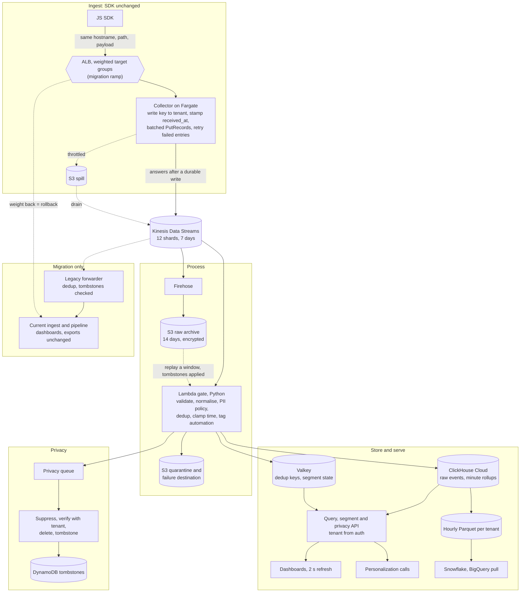

# Engineer 004: real-time analytics pipeline

**Brief version: 2026-07**, from `challenges/engineer-004/brief.md` in https://github.com/ericosiu/beat-claude at commit `4b719e45` [Observed]. **Fixture:** `fixtures/event_sample.jsonl`, SHA-256 `1aeb24b415009e89fcf8acb5a178410faf216dc17b16920d9849ecc8bbb24235`, 25 lines. Every `event_id` below comes from `analyze_fixture.py` (one command, section 7); mechanics are detailed in `docs/design_notes.md`.

## 1. Written answer

### Decision and arithmetic

[Estimated] 50M events a day is 579 events/s, 5,787 at a 10x spike; at 1 KB per event [Assumed], 5.8 MB/s at peak, 50 GB a day, 1.5 TB a month. That is small, so the complexity goes where the risk is: correctness and migration. A collector behind the existing SDK hostname writes each event to Kinesis before answering. A Python Lambda, the gate, validates, deduplicates and tags events with the rules `analyze_fixture.py` runs on the fixture. ClickHouse serves dashboards from minute rollups, Valkey holds dedup keys and per-visitor segments, Firehose keeps a raw archive in S3 for replays. No Flink, no Kafka.

[Estimated] Monthly list cost (`cost_model.py`, AWS Price List API): ClickHouse $2.7K, Valkey $0.5K, Kinesis $0.3K, collector and ALB $0.3K, Firehose $0.2K, rest $0.6K, staging $1.6K: **$6.3K, 13% of the ceiling**. Provisioned for 25x: $7.6K. A permanent 10x volume: $24.7K, over the ceiling if ClickHouse compute must grow tenfold too.



### Choices, and what I rejected

| Layer | Choice | Rejected, and why |
|---|---|---|
| Front door | ALB (weighted target groups for the migration, capacity reserved before known peaks [Benchmarked]) and a stateless Fargate collector mimicking today's endpoint: write key to tenant, `received_at`, batched `PutRecords` retrying failed entries, S3 spill. | API Gateway to Kinesis: one request per `PutRecord`, no partial-failure handling, a 10,000 req/s account throttle [Benchmarked], $1.4K against $310 [Estimated]. |
| Buffer | Kinesis, provisioned: 5,787 records/s need 6 shards at 1,000 each [Benchmarked]; 12 for headroom [Assumed], 7 days. | On-demand: absorbs twice the previous 30-day peak, then throttles up to 15 minutes [Benchmarked]: Black Friday. MSK: Kafka operations the team lacks. |
| Processing | Lambda (Python, Powertools batch). Bad data is quarantined in code, so a failing batch means an outage or a bug: it retries up to 6 days, inside the 7-day retention, with bisect, partial batch responses and an S3 last-resort destination. | Managed Flink: state this volume does not need, JVM skills, 60 s default checkpoints, 15-minute autoscaling [Benchmarked], and the same clock clamping: a naive watermark calls 17 of 24 fixture rows late, pushed by two future clocks [Observed] (`watermark_simulation` in `anomaly_report.json`). Revisit for funnels. |
| Store | ClickHouse Cloud (Scale, same region, PrivateLink): async inserts, minute rollups, monthly partitions, TTL on server time, queries only through views that require a tenant, per-tenant quotas. | Redshift Serverless: $2.2K for 8 warm RPU [Estimated], AWS-native, so the fallback if data must stay in our account. PostgreSQL, OpenSearch: not built to scan and aggregate billions of rows. |
| Archive, exports | Firehose to S3 by date, 14 days; hourly Parquet per tenant for Snowflake and BigQuery. | Firehose by tenant: 500 active partitions by default [Benchmarked]. |

### Event model and identity

[Assumed] The SDK sends a write key, checked against the payload `tenant_id` (the only tenant field in the fixture). `event_time` is the client time unless over 1 s ahead of `received_at` or older than 7 days, then `received_at`; the client value is kept, and partitions, TTL and freshness use `received_at`. `identify` adds `(tenant_id, anonymous_id, user_id, first_seen)` to a links table and moves the visitor's segment counters to the user. Earlier anonymous events are attributed at query time, never rewritten, never across tenants; two users on one device are never merged.

### What the pipeline does with this fixture

[Observed] 18 anomalies on 14 of 25 lines, 11 certain and 7 suspected. Routing, one decision per line: 11 accepted, 10 accepted with flags, 1 duplicate dropped, 2 quarantined, 1 privacy request. Reasons, confidence and false-positive risk: `artifacts/anomaly_report.json`.

| Class [Observed] | event_id | Handling |
|---|---|---|
| Duplicate, late | evt-0002, line 5 | Same payload, 7.43 s after line 2 (an SDK or proxy retry), 7.56 s after its client time, out of receipt order. Idempotent write on (tenant_id, event_id); rollups merge by event-time bucket. |
| Clock ahead | evt-0005, evt-0006, evt-0016 | 47 s, 65 min, 365 days ahead, while the same visitors' 1 to 3 other events lag normally: more likely bad events than bad devices. evt-0006 shares its milliseconds with its receipt, evt-0016 is a year ahead within 212 ms: hints of a wrong field, not proof. Event time becomes `received_at`. |
| Personal data | evt-0007 | `contact_email`, `phone`: dropped or tokenised before logs, metrics, dashboards, exports. |
| Legacy schema | evt-0009 | `pageview`, `timestamp`, `page_path`, `ref`, no `received_at`: old SDK, versioned alias map. |
| Missing tenant | evt-0011 | Quarantined, never guessed. |
| Truncated JSON | evt-0020 | Quarantined raw, so it cannot block a shard. |
| Automation | evt-0012 to evt-0015 | 4 page views, 4 paths, 50 ms, one visitor: tagged, out of segments and default counts, kept raw. |
| Identity | evt-0003, evt-0008, evt-0022 | Make evt-0001, evt-0002, evt-0004, evt-0005, evt-0007 attributable; evt-0016, evt-0017 have no `identify`. |
| Browser counter | evt-0019 | `count_today=3`, but 1 deduplicated /pricing view (evt-0001); 3 is every /pricing line, duplicate included. |

**Not acted on at face value** [Observed]: (1) evt-0017: anyone can post a deletion for any user id to a public endpoint; its u-1077 to anon-77a link is asserted only by itself; "all data" is not the tenant. (2) The `scanner.example-bot.net` referrer of evt-0012 to evt-0015: browser-supplied, maybe the tenant's own scanner; the 17 ms gaps are the evidence. (3) evt-0019's counter: "viewed pricing 3x" would fire on a number the server cannot reproduce. (4) The clocks of evt-0006 and evt-0016: a guessed offset invents data. (5) evt-0007's e-mail: maybe someone else's, never an identifier. Nor do 25 seeded lines yield any rate.

### Delivery guarantees, freshness, spikes

[Benchmarked] Kinesis, Lambda and Firehose deliver at least once and clients retry, so effects are idempotent and dedup keys are claimed only after the write: the gate drops events Valkey marks committed, inserts the rest into ClickHouse with a deterministic token, then a Lua script marks them committed and moves segment counters for new keys only. A failed insert leaves no mark, so retries lose nothing; a crash between insert and mark can double a row, which nightly reconciliation (rows against distinct event ids per tenant-hour) removes before rebuilding those rollups.

[Estimated] Zero loss is an accounting check: every accepted event is stored, quarantined or dropped as a duplicate; the S3 failure destination is a debt that pages, never an outcome. The collector answers once Kinesis or S3 holds the event, so overload costs freshness, not data. What dies before the ALB is invisible to any server; reserved capacity keeps that edge open.

[Estimated] Freshness: about 2.5 s expected, 5.0 s worst case without backlog, with Lambda polling each shard every second and ClickHouse flushing async inserts within 1 s [Benchmarked]; so the target is a p95 SLO, not a bound. [Observed] The fixture's normal client-to-server lag is 119 to 206 ms (`normal_lag_ms` in `anomaly_report.json`), consistent with an SDK that sends at once; week 1 measures it per SDK version. Spikes: 12 shards take 12,000 records/s, 9 collector tasks stay on [Assumed: 1,000 requests/s each until load-tested], ParallelizationFactor 2 covers about 480 records per shard-second, shards double before known events.

### Compliance built into the data layout

**evt-0017.** [Benchmarked] GDPR allows one month (Art. 12(3)), CCPA 45 days. (1) Suppression within the hour, reversible and rate-limited per tenant, so the public endpoint cannot hide visitors at will. (2) The tenant, as controller, confirms in its console. (3) Deletion covers the user and the visitor ids linked to that user, never another user's records (a shared device goes to a human), bounded by receipt time: evt-0006 is caught although its client time is later than the request's [Observed] (`privacy_requests` in `anomaly_report.json`). A daily batch deletes raw rows, rebuilds affected rollups, clears Valkey, rewrites exports and feeds customers a deletion list; archive, quarantine and failure buckets expire at 14 days, backups at 7. (4) A tombstone `(tenant_id, subject ids, cutoff)` filters the gate, replays and the migration forwarder; the old pipeline runs its own deletion until retired.

**evt-0007, isolation.** [Assumed] The PII policy runs in the gate before every write but the raw archive (encrypted, restricted, 14 days); logs and metrics carry ids, never payloads. The tenant comes from the session, never a parameter. KMS, TLS, one IAM role per component, CloudTrail: SOC 2-ready design, not SOC 2, which is an auditor's report on controls run for months.

### Migration without breaking integrations

[Assumed] (1) Weeks 1 to 3: count events per tenant-hour in today's ingest and dashboards to locate the 3% loss; turn recorded SDK requests into contract tests; send customers the sub-processor notice for ClickHouse Cloud. (2) Weeks 4 to 7: the SDK hostname moves once to the new ALB, which forwards everything to today's ingest, then shifts 1%, 10%, 50%, 100% of requests to the collector, a week per step; a forwarder replays each accepted event, with its request metadata, into today's ingest, so old dashboards, exports and integrations see no change. Rollback: weight back, in seconds. (3) Weeks 7 to 9: parallel run. (4) Weeks 9 to 12: dashboards move by tenant cohort behind a flag. (5) Month 6: decommission.

[Assumed] Accuracy is verified when, for 14 days with a weekend peak, every tenant-hour has zero unaccounted events, rows equal distinct event ids, and the deduplicated count is no lower than the old minus 0.1%, each difference explained; canary freshness p95 is under 5 s; a 1-hour replay at 10x the 30-day peak loses nothing. Rollback triggers include any unaccounted event and collector 5xx over 0.1% for 5 minutes (`docs/migration_plan.md`).

### Scope, SLOs, trade-offs

[Assumed] **MVP, 3 months:** collector, Kinesis, gate, archive, ClickHouse with per-tenant quotas, real-time dashboards for all tenants, privacy workflow, reconciliation, canary, migration through step 4. **Months 4 to 6:** segments, personalization API, exports, per-tenant retention, decommission. Engineer A owns ingest and reliability, B the store, API and parity. **SLOs:** freshness p95 under 5 s from a canary tenant; 100% of accepted events accounted per tenant-day; 99.95% of collector requests answered 2xx; dashboard API p95 under 1 s.

I optimize for durability, correctness and a migration two people can run, and give up sub-second freshness, exactness before reconciliation, and vendor neutrality (ClickHouse Cloud is a third-party processor). With more time: pack events into Kinesis records to cut shards and the Firehose bill (records round up to 5 KB [Benchmarked]), and load-test ClickHouse before sizing it.

## 2. Operating artifact

[Observed] In the repo of section 7: `analyze_fixture.py` (the gate: standard library, generic rules, no hard-coded id), 48 tests, `cost_model.py` with pinned AWS prices, and `docs/` (design notes, migration plan, sources).

## 3. Evidence log

| Claim | Tier | How to check |
|---|---|---|
| 18 anomalies on 14 lines [Observed] | Tier 3: output on the source record | `python3 analyze_fixture.py`, `artifacts/anomaly_report.json` |
| Rules hold on edge cases | Tier 2: tested artifact | `python3 -m unittest discover -s tests` |
| Client time marks 17 of 24 late [Observed] | Tier 3 | `watermark_simulation`, `anomaly_report.json` |
| $6.3K a month [Estimated] | Tier 3: calculation with sources | `cost_model.py`, `docs/aws_prices_snapshot.json` |
| Over 30,000 events/s on one M3 core, so I/O is the bottleneck [Observed] | Tier 3: timing runs | `python3 analyze_fixture.py --bench 200000` |
| Under 5 s, no loss at 10x | Tier 0: reasoning, unmeasured | load test and canary, `docs/migration_plan.md` |

No Tier 4 or 5: nothing ran in production. Command outputs: `artifacts/evidence_log.md`.

## 4. Number source labels

Every paragraph and table is labelled: [Observed] measured by this repo's scripts, [Estimated] computed in `cost_model.py`, [Benchmarked] sourced in `docs/references.md`, [Assumed] awaiting a measurement.

## 5. AI usage disclosure

I used Claude Code (Anthropic). Under rules I set (label every number, invent nothing, show what is not acted on, run offline), it wrote and ran the code and tests, researched documentation through sub-agents that had to quote each page, and drafted this text. Checked by execution: tests, committed reports byte-identical to a fresh run, the official pre-screen with `--strict`. A separate review agent then tried to refute the design; its findings, such as a deletion that could reach another user on a shared device, were fixed and tested. Weak spots: vendor behaviour comes from documentation, not a deployment, and [Assumed] inputs are unmeasured. The gate uses no model; event text is never an instruction.

## 6. Failure handling: what breaks it, and what stays human

**What breaks it** [Assumed]: an SDK batching in the browser or reusing ids (watch lag and derived ids per SDK version); events without a visitor id piling on one key (watch shard throttling, salt the key); an undersized ClickHouse (insert latency, parts, query p95); a slow old system (forwarder lag per tenant); a Valkey failover (segments rebuilt from ClickHouse); a store missed by a deletion (a weekly test subject, deleted then searched for).

**What stays human:** unusual deletions (many subjects, tenant-wide, shared devices, outside the console); changes to retention, tombstones or PII policy; replays and backfills; each migration step; quarantine review; the sub-processor decision (ClickHouse Cloud or the AWS-native fallback) and its notice to customers. No model makes these calls.

## 7. Artifact access

Public, no login: https://github.com/searadacunha/singlegrain-realtime-analytics-challenge. [Observed] Standard library only, CI on Python 3.10 and 3.13, no AWS account or key.

```
git clone https://github.com/searadacunha/singlegrain-realtime-analytics-challenge
cd singlegrain-realtime-analytics-challenge
python3 analyze_fixture.py        # prints the fixture SHA-256, writes artifacts/
python3 -m unittest discover -s tests
python3 cost_model.py --print
```

`--expect-sha256 <hash>` fails on a different fixture; `--fixture` and `--out-dir` take a rotated one.
